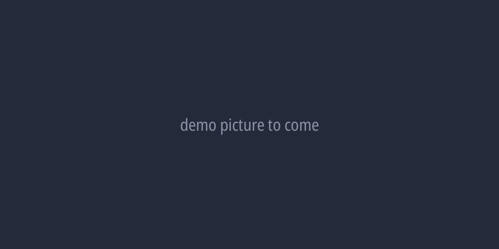

# wl-cast

Use your Wayland screen from a browser on another device, interactively. Nothing to install on the other side, so it can work in a car web browser as well.

I wrote it for my Linux phone (an F(x)tec Pro¹x running Guix and Sway), so I can enjoy all my usual Linux utilities and programs (music player, music streaming, and everything else) in my car or on any other machine with a browser. It needs Sway for now (the capture alone works on any wlroots compositor) and a V4L2 hardware H.264 encoder.

## How it works

- `wl-cast-capture` copies the screen into GPU buffers, converts them to NV12 and hands them to the hardware encoder as DMA-BUFs. Pixels never go through the CPU, which decreases latency and increases performance.
- `wl-cast-server` serves the page and streams the video and the sound over WebRTC. Touches and keys come back over a data channel and are played on virtual input devices.
- The same stream is also served as HLS at `/live.m3u8` (with `?k=KEY` when there is a key), for players that take a URL and play it themselves, like a Chromecast (`catt cast http://ADDRESS:8081/live.m3u8?k=KEY`), VLC or mpv. It is some seconds behind, so it suits watching a video, not typing. `wl-cast start -l 1280 -f 24 -b 2` lowers its size, rate and bit rate if it stalls or the phone gets hot.
- `wl-cast` starts and stops it: `wl-cast start` asks which screen to stream if you have several and prints its links (each address it can be reached on, with the interface), `wl-cast stop` ends it.

Two helpers come with it. `wl-cast-screen` streams a screen made at the size of the viewer's window instead of your own (`wl-cast start -s client`), so the picture fills a car's display for instance, and it follows when the window is resized. `wl-cast-cert` gets a real certificate for a domain of yours, for browsers that refuse local addresses and self-signed certificates, like some cars' browsers ([HTTPS.md](HTTPS.md)).

You can add your own scripts around it, _e.g._, `examples/car-bluetooth` starts the hotspot and the stream when the car connects over Bluetooth. Copy it to `~/.local/bin`, set the names at its top, and start it from your Sway config (`exec ~/.local/bin/car-bluetooth`).

## Your own buttons and gestures

The page has a few buttons of its own (sound, keyboard, settings). Add yours in `~/.config/wl-cast/buttons`, one per line with a label and a command/script, _e.g._, a window switcher, a launcher, an on-screen keyboard. `examples/buttons` has placeholders. Three fingers tapped on the page fold or show the buttons; held, they show them on a wheel around the fingers, which hides once one is pressed. DIM shows held while the screen is dimmed. Each row of buttons has an arrow that moves it to the top or the bottom on its own, out from under something that covers that edge; the keys' arrow sits at the right end of its row.

Everything specific to your host goes in an optional `~/.config/wl-cast/hook` script, see `examples/hook`: keeping the screen awake, Wi-Fi power saving, and your gesture tool on the viewer's touches, so edge swipes work from the stream as they do on the screen for instance.

While it streams, the sound plays on your output and on a new one, "Stream viewer", which is what the viewer hears: pick your own output alone in your sound settings to keep the sound on the host, Stream viewer alone to hear it only on the viewer's side. Both come back as before when the stream ends (it needs `pactl`). Without `-s`, the stream starts in the screen mode last chosen on the page.

The screen stays awake while streaming (`-w off` to let it blank), through your hook or else by pausing swayidle. A screen turned off is not captured, so with `wl-cast start -d`, the key that normally blanks it (the power key, bound to `wl-cast dim || <your blank command>`) toggles a black screen instead while the stream runs, and blanks as usual otherwise. `-T` also turns the screen's own touch input off while dimmed. The brightness comes back when the stream ends.

By default any device that reaches the host's address can open the link (`-v lan`); `-v hotspot` keeps it to the host's own hotspot, and `-v usb` to a computer on a USB cable: with USB networking (a Linux phone's usual USB gadget), plug the phone into a laptop and open the `usb0` link, no Wi-Fi needed. `-n` streams for watching only, without touch, keys or buttons. Distributions can ship default `buttons` and `hook` files in `/etc/xdg/wl-cast/`; the user's own in `~/.config/wl-cast/` win. `-v wan` also prints a public link through Tailscale Funnel, for a viewer on none of your networks: the key in the link and `-A` (approval on the host) guard it. `wl-cast start -v wan` says what Tailscale still needs. The page goes through Funnel; the video still takes the most direct way WebRTC finds.

## Performance

Measured on the Pro¹x (Snapdragon 662, Venus encoder), streaming at 960x480 to Chromium on a PC on the same Wi-Fi:

| | |
|---|---|
| screen to encoded frame | about 20 ms, 30 ms at worst |
| frames | 30 per second while the picture moves, none lost |
| screen to browser | about 60-70 ms on a good Wi-Fi link (6-10 ms round trip, 30 ms of browser buffer); a bad link adds hundreds of ms |
| CPU | about 40 % of one core (server 27 %, capture 8 %, sound 8 %), plus 3 % in Sway |
| GPU | about 19 % of its time for the conversion to NV12, plus 1 % in Sway |
| heat | about 6 °C more after a few minutes |
| for comparison, the usual capture path (xdg-desktop-portal-wlr, PipeWire, GStreamer) | frames 400 ms old, more than a core |

Use 5 GHz Wi-Fi if you can: on the 2.4 GHz band of the same router, the phone took 500 ms to reach it, against 8 ms on 5 GHz.

## Install

On Guix, from my channel (add it to `~/.config/guix/channels.scm`):

    (channel
      (name 'mlaparie-guix-private-channel)
      (url "https://git.sr.ht/~mlaparie/guix-private-channel"))

then `guix install wl-cast`.

## Build

Needs wayland, wayland-protocols, wlr-protocols, mesa (gbm, EGL, GLES 2) and libdrm; the server needs Python 3 and GStreamer with its WebRTC plugins.

    make
    make install PREFIX=~/.local

## To do

- KDE and GNOME: capture through the screen-cast portal (PipeWire still gives DMA-BUFs), and through ext-image-copy-capture where the compositor has it.
- Input on other compositors: the virtual devices are fine, but the screen handling uses swaymsg.
- Other encoders than Venus: tested on that one only.

## Disclaimer

This project used AI assistance. I am not particularly proud of it, but none of this would have been possible if I were coding it alone. Everything was however directed and tested by a human, with some organic code writing and review as well. Expect rough edges still: this was written and tested on a mobile Linux device only. PRs are welcome.

## License

AGPL-3.0-or-later. The code started in [fxtec-pro1x-guix](https://git.sr.ht/~mlaparie/fxtec-pro1x-guix).
